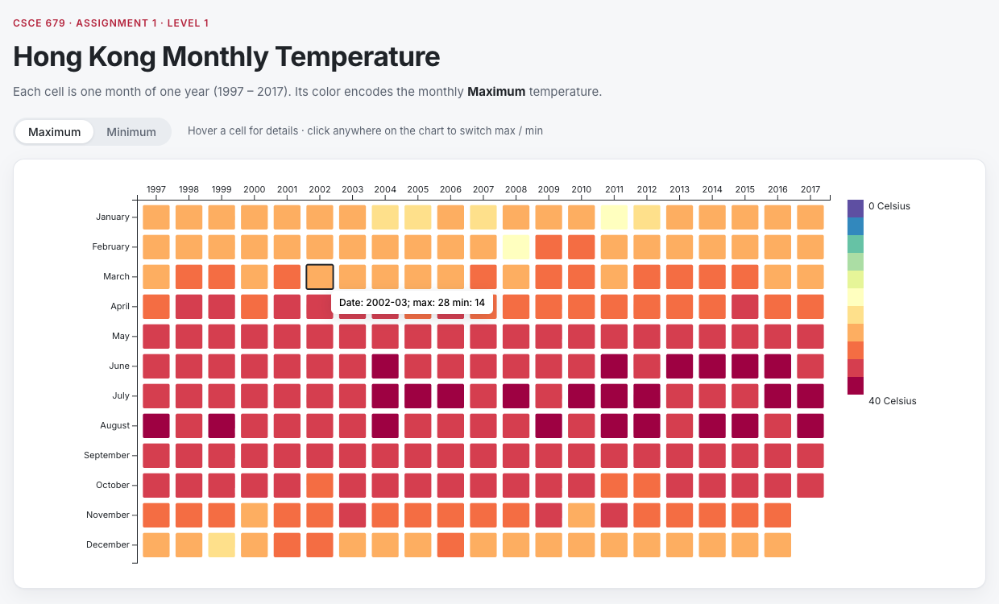
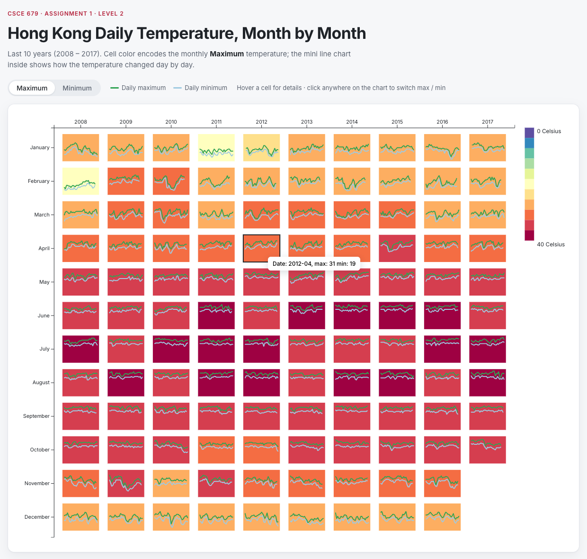

# CSCE-679-Data-Visualization-Assignment1

## Level 1 & 2 (Basic): [Link](./level1.md)

# Solution: Hong Kong Temperature Heatmap (D3.js v7)

| Level 1: Year / Month heatmap | Level 2: heatmap + daily line charts |
| --- | --- |
|  |  |

## How to run

- **Online:** <https://alimuratyusup.github.io/CSCE-679-Data-Visualization-Assignment1/>
- **Locally:** double-click `index.html`, `level1.html` or `level2.html`. No server, install or internet needed.
- **Optional local server:** `python -m http.server 8000`, then open <http://localhost:8000/>.

## What each level shows

- **Level 1:** x = year (1997–2017), y = month; cell color = monthly maximum (highest daily max) or minimum (lowest daily min) temperature.
- **Level 2:** the same matrix for the last 10 years (2008–2017), plus a mini line chart in each cell (x = day of month, y = temperature; green = daily max, light blue = daily min).
- **Interactions:** hover a cell for a tooltip (e.g. `Date: 2002-03; max: 28 min: 14`); click the chart or use the Maximum / Minimum toggle to switch modes.
- **Legend:** 11-step color legend from 0 to 40 °C.

## Code structure

```
index.html              overview page linking both levels
level1.html             Level 1 page (passes LEVEL1_CONFIG to the app)
level2.html             Level 2 page (passes LEVEL2_CONFIG to the app)
css/style.css           page shell, axes, tooltip and toggle styling
js/config.js            ALL settings: data path, colors, sizes, spacing, per-level options
js/data.js              load the data, aggregate daily rows into monthly records, filter years
js/heatmap.js           reusable Year/Month matrix: scales, axes, cells, hover, click-to-toggle
js/sparkline.js         mini line charts inside the cells (Level 2)
js/legend.js            vertical color legend
js/tooltip.js           floating tooltip + tooltip text formatting
js/controls.js          Maximum / Minimum toggle buttons
js/app.js               entry point: load -> aggregate -> draw -> connect toggle
js/temperature-data.js  generated copy of the CSV, used when a page is opened from disk
js/vendor/              local copy of D3 v7.9.0 (works offline)
tools/embed_data.py     regenerates js/temperature-data.js from temperature_daily.csv
```

Each module has one job, and both levels reuse the same modules. A level is only a config object.

## Common changes

| Want to… | Change |
| --- | --- |
| Show the last 5 years in Level 2 | `LEVEL2_CONFIG.recentYearCount = 5` |
| Add sparklines to Level 1 | `LEVEL1_CONFIG.showSparklines = true` and give it a `sparkline` block |
| Bigger / smaller cells | `cellStepX`, `cellStepY`, `cellPadding` in the level config |
| Different color scheme | `createColorScale` in `js/heatmap.js` and `SHARED_CONFIG.color` |
| Start in "min" mode | `SHARED_CONFIG.initialMode = "min"` |
| Use another data file | `SHARED_CONFIG.dataUrl` and `SHARED_CONFIG.columns`, then run `python tools/embed_data.py` |
